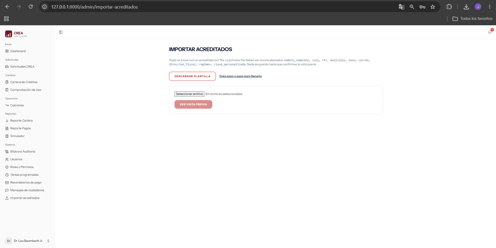
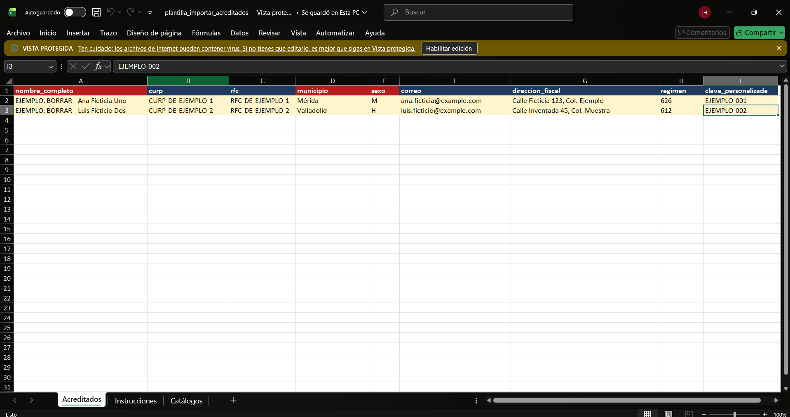
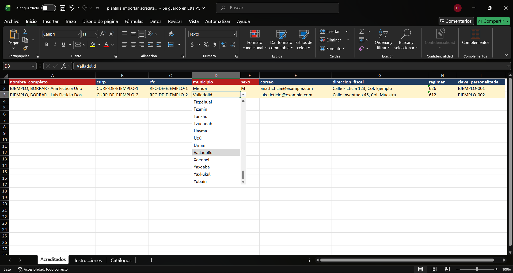
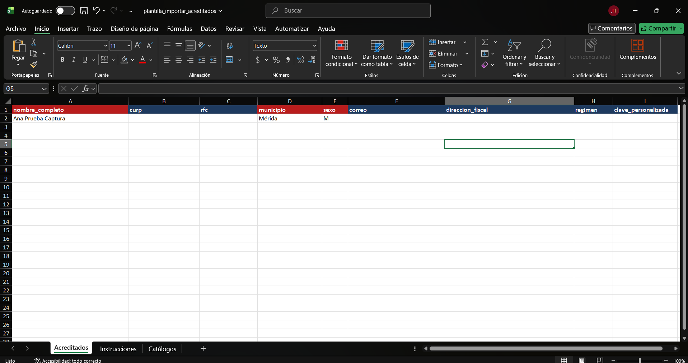
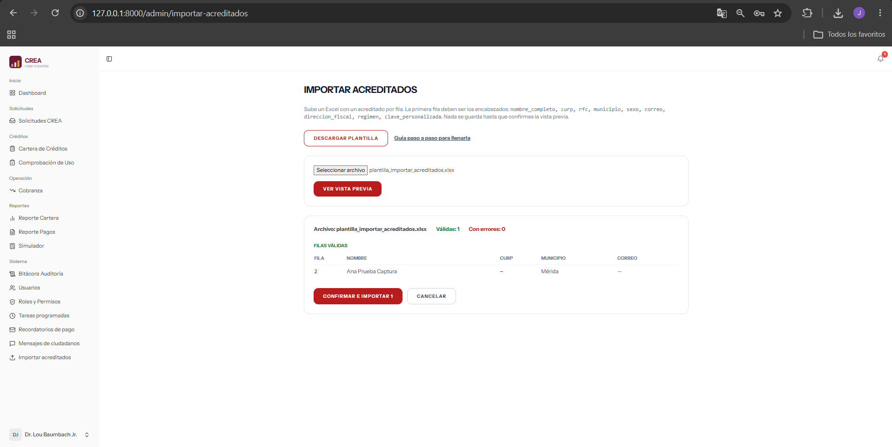

# Importar acreditados desde Excel

Guía para administradores. El importador da de alta a varios acreditados a la vez desde un archivo de Excel. Solo guarda sus datos personales: no crea créditos.

Está en el menú lateral: **Sistema → Importar acreditados**. Solo lo ven los usuarios con rol Administrador.

En resumen:

1. Descarga la plantilla.
2. Llénala, un acreditado por fila.
3. Súbela y revisa la vista previa. Hasta aquí no se guarda nada.
4. Corrige lo que marque en rojo, o confirma para guardar las filas que están bien.

---

## 1. Descarga la plantilla

En **Importar acreditados**, presiona **Descargar plantilla**. Se descarga el archivo `plantilla_importar_acreditados.xlsx`.

Descarga una plantilla nueva cada vez que vayas a importar. Así siempre tiene las columnas y los catálogos al día.

---

## 2. Llena la plantilla

La plantilla tiene tres hojas:

| Hoja | Para qué sirve |
|---|---|
| **Acreditados** | Aquí van los datos: un acreditado por fila, desde la fila 2. |
| **Instrucciones** | Qué poner en cada columna, con un ejemplo y los errores más comunes. |
| **Catálogos** | Los municipios, sexos y regímenes fiscales que acepta el sistema. |

### Antes de empezar

- **Borra las 2 filas amarillas** que dicen «EJEMPLO, BORRAR». Son de muestra: si las dejas, el importador las rechaza y no se guardan.
- **No cambies los encabezados** de la fila 1: no les cambies el nombre, no los muevas y no los borres. El importador busca las columnas por ese nombre.
- **Los encabezados en rojo son obligatorios:** `nombre_completo`, `municipio` y `sexo`. Las demás columnas se pueden dejar vacías.

### Qué poner en cada columna

| Columna | Obligatoria | Qué poner |
|---|---|---|
| `nombre_completo` | Sí | Nombre(s) y apellidos, como en su identificación. |
| `curp` | No | Los 18 caracteres de la CURP. Puede ir en minúsculas. |
| `rfc` | No | RFC con homoclave: 13 caracteres para persona física y 12 para moral. |
| `municipio` | Sí | El municipio, elegido de la lista de la celda. |
| `sexo` | Sí | `H` (hombre) o `M` (mujer). |
| `correo` | No | Su correo electrónico. |
| `direccion_fiscal` | No | Calle, número, colonia y municipio, como en la constancia del SAT. |
| `regimen` | No | El código de 3 números del régimen fiscal, elegido de la lista de la celda (por ejemplo `626` es RESICO). |
| `clave_personalizada` | No | La clave de pago, si tiene una. |

La hoja **Instrucciones** tiene más detalle de cada columna.

### Listas de la celda

En **municipio**, **sexo** y **régimen**, al hacer clic en la celda aparece una flecha con la lista de valores. Elige de ahí para no tener errores de escritura.

> **Importante:** el importador **no** marca error si un municipio o un régimen está mal escrito, por ejemplo «Merida» sin acento o el nombre del régimen en lugar del código. Se guarda tal cual, y luego ese acreditado sale aparte en los reportes por municipio. Por eso conviene elegir siempre de la lista.

### Guarda el archivo

Guárdalo como Excel (`.xlsx`). Puede pesar hasta 2 MB, y en ese tamaño caben miles de acreditados.

No importa en qué hoja estés cuando guardes: el importador siempre lee la hoja Acreditados.

---

## 3. Sube el archivo

1. En **Importar acreditados**, elige tu Excel con el botón de archivo. Según el navegador dice «Elegir archivo» o «Seleccionar archivo».
2. Presiona **Ver vista previa**.

Todavía no se guarda nada.

Si el archivo completo tiene un problema, no aparece la vista previa y sale un mensaje arriba:

| Mensaje | Qué hacer |
|---|---|
| Selecciona un archivo. | No elegiste ningún archivo. |
| El archivo debe ser Excel (.xlsx o .xls). | Guárdalo como Excel, no como CSV o PDF. |
| El archivo no puede pesar más de 2 MB. | Divide los acreditados en dos archivos. |
| No se pudo leer el archivo. Verifica que sea un Excel válido. | El archivo está dañado o no es Excel. Ábrelo en Excel y guárdalo otra vez. |
| Al archivo le faltan las columnas: … | Cambiaste o borraste un encabezado obligatorio. Descarga la plantilla de nuevo y copia ahí tus datos. |
| El archivo no tiene filas con datos. | La hoja Acreditados está vacía. |

---

## 4. Lee la vista previa

Arriba de la vista previa sale el nombre del archivo, cuántas filas están bien (**Válidas**) y cuántas tienen problemas (**Con errores**).

- **Filas con errores:** no se van a guardar. Cada una dice su número de fila en Excel y el motivo.
- **Filas válidas:** son las que se guardarán al confirmar.

El número de fila es el mismo que ves en Excel, así que puedes ir directo a corregirla.

### Qué significa cada error

| Mensaje | Qué pasó | Cómo corregirlo |
|---|---|---|
| Falta el nombre completo. / Falta el municipio. / Falta el sexo. | La celda obligatoria está vacía. | Llénala. |
| El sexo debe ser H o M. | Se escribió «Hombre», «Mujer» u otra cosa. | Escribe solo `H` o `M`. |
| La CURP no tiene un formato válido. | Le falta o le sobra un carácter, tiene espacios, o tiene la letra O en lugar de un cero. | Cópiala de nuevo de la CURP oficial. |
| El RFC pasa de 13 caracteres. | Tiene guiones o espacios. | Escríbelo sin guiones ni espacios. |
| El correo no es válido. | Le falta la @, tiene espacios o una coma en lugar de un punto. | Corrígelo o deja la celda vacía. |
| La dirección fiscal pasa de 500 caracteres. | El texto es muy largo. | Resúmela. |
| Ya existe un acreditado con esta CURP. / … con este RFC. | Esa persona ya está dada de alta en el sistema. | Ver «Duplicados». |
| CURP: ya aparece en la fila N del archivo. / RFC: … | La misma persona está dos veces en tu archivo. | Ver «Duplicados». |

---

## 5. Duplicados

El sistema no acepta dos acreditados con la misma CURP o el mismo RFC.

- **Repetido dentro del archivo** («ya aparece en la fila N»): la primera fila queda como válida y la repetida se marca. Revisa cuál tiene los datos correctos y deja solo esa.
- **Ya existe en el sistema** («Ya existe un acreditado con esta CURP»): esa persona ya está dada de alta y no hace falta importarla. Si sus datos cambiaron, edítala en **Acreditados**.
- **Alguien la capturó mientras revisabas la vista previa:** al confirmar se salta y el mensaje final dice «Omitidos porque ya existían: N».

---

## 6. Confirma la importación

Si las filas válidas están bien, presiona **Confirmar e importar**. El sistema pide confirmación y después guarda **solo las filas válidas**.

- Al terminar sale «Acreditados importados: N».
- Las filas con errores **no se guardan**. Corrígelas en tu Excel, borra las filas que ya se importaron y sube el archivo otra vez. Si dejas las que ya se importaron, ahora saldrán como «Ya existe un acreditado».
- Si presionas el botón dos veces, solo se importa una vez.
- **Cancelar** descarta la vista previa sin guardar nada.

Los acreditados importados aparecen en la lista de **Acreditados**.

---

## Para el equipo técnico

- La plantilla se genera en `app/Services/PlantillaImportarAcreditados.php` a partir del importador (`ImportarAcreditadosController`):
  - las columnas salen de `COLUMNAS`;
  - lo obligatorio y los máximos salen de `reglas()`;
  - los mensajes de la hoja Instrucciones son los que da el propio validador.
- Los catálogos salen de `Portal\WizardSolicitudController::MUNICIPIOS_YUCATAN` y `AcreditadoController::regimenesFiscalesSat()`, y el sexo, de la regla `in:H,M`.
- Si cambian las columnas o las reglas del importador, la plantilla cambia sola. Las pruebas de `tests/Feature/PlantillaImportarAcreditadosTest.php` revisan que sigan coincidiendo.
- Las capturas de esta guía están en `docs/img/importador/` y usan datos de prueba.
