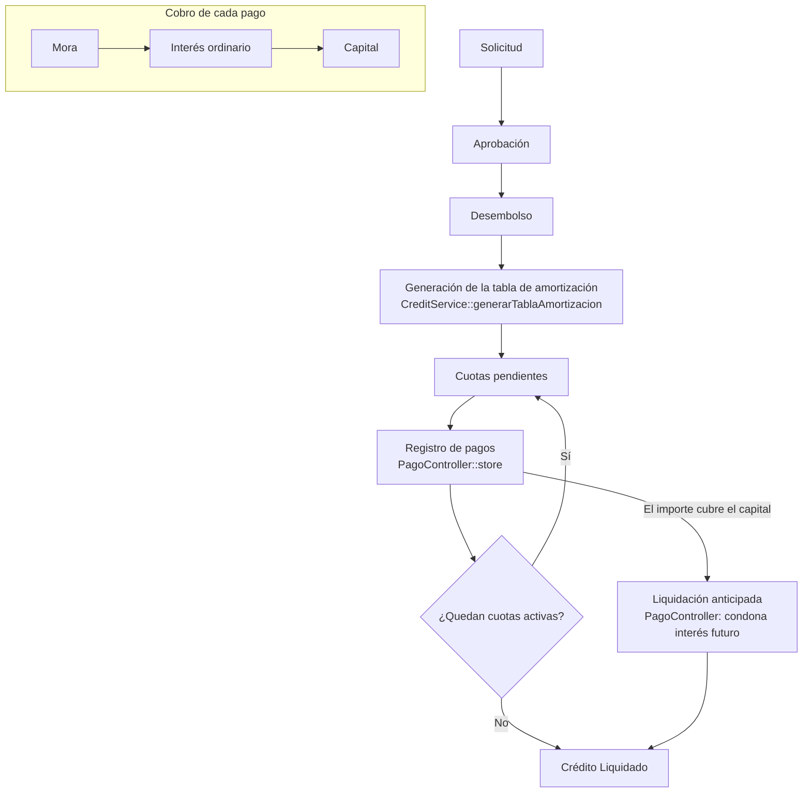
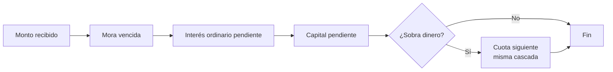

# El motor de crédito de CREA

Este documento explica cómo CREA calcula y cobra un crédito: cómo nace la tabla
de amortización, cómo se aplica el dinero de un pago, cómo se genera la mora y
qué pasa cuando alguien quiere liquidar antes de tiempo. Está escrito para
alguien que **nunca ha visto CREA**: si al terminarlo puedes explicar con tus
palabras cómo se aplica un pago, el documento cumplió.

Todos los números de línea citados corresponden al código **al momento de
escribir esto**. Si el código se movió, busca por nombre de método, no por
línea.

---

## 1. Cómo se genera la tabla de amortización

**Archivo:** `app/Services/CreditService.php`
**Método:** `generarTablaAmortizacion()` (líneas 15-72)

Cuando se da de alta un crédito, este método crea una fila por cada cuota en la
tabla `amortizaciones`. Las cuotas se calculan con el **sistema francés**: cuota
fija durante toda la vida del crédito (la última se ajusta por redondeo).

### 1.1 La tasa mensual

La tasa se guarda **anual** en el crédito y aquí se convierte a mensual
(línea 23):

```php
$tasaMensual = ($tasaOrdinariaAnual / 100) / 12;
```

Es decir: se pasa de porcentaje a fracción (÷100) y se reparte en 12 meses. Una
tasa anual del 12% es una tasa mensual del 1% (`0.12 / 12 = 0.01`).

### 1.2 La fórmula de la cuota fija

La cuota constante se calcula en las líneas 45-47:

```php
$cuotaFija = ($tasaMensual > 0)
    ? $monto * ($tasaMensual / (1 - pow(1 + $tasaMensual, -$plazo)))
    : $monto / $plazo;
```

En notación matemática, con **M** = monto, **i** = tasa mensual y **n** = plazo
en meses:

```
        M · i
C = ─────────────
     1 − (1 + i)^(−n)
```

Qué significa, en español:

- El numerador (`M · i`) es el interés de un solo mes sobre el monto completo.
- El denominador corrige ese interés para que la cuota, repetida **n** veces y
  descontada a la tasa **i**, alcance exactamente a pagar el monto **M**.
- El resultado **C** es la cuota fija. Al principio casi toda la cuota es
  interés y muy poco capital; al final se invierte (casi todo capital y poco
  interés). El total pagado sí "cabe" exactamente en M más sus intereses.

### 1.3 Si la tasa es 0 (modalidad Artesanal)

Si `$tasaMensual` es 0, la fórmula anterior dividiría entre cero, así que el
código **degrada a capital fijo sin interés** (el `else` de la línea 47):

```
C = M / n
```

La cuota es simplemente el monto repartido entre el número de meses. El
interés de cada cuota queda en 0. Esto corresponde a la modalidad **Artesanal**,
que no cobra interés ordinario (ver también la sección 3: sin tasa ordinaria,
tampoco se genera mora).

### 1.4 El recorrido de las cuotas (líneas 49-71)

El bucle va de la cuota 1 a la n y en cada vuelta:

1. Calcula el **interés** sobre el saldo que aún se debe:
   `$interes = round($saldo * $tasaMensual, 2)`.
2. Calcula el **capital** de esa cuota: `$cuotaFija − $interes`. La **última**
   cuota no usa esa resta: se lleva todo el saldo restante (`round($saldo, 2)`)
   para que el crédito cierre en cero pese a los redondeos de centavos.
3. Guarda la fila con `saldo_insoluto` (lo que se debía *antes* de esta cuota),
   `capital_esperado`, `interes_ordinario_esperado` y `cuota_fija`.
4. Resta el capital pagado al saldo: `$saldo -= $capital`.

La primera cuota vence un mes después de la fecha inicial
(`addMonths($i + $mesesGracia)`, línea 57): si hay período de gracia, las
cuotas reales arrancan después de él.

### 1.5 La gracia de la modalidad Sustentable y por qué el número es negativo

Si el nombre de la modalidad contiene "sustentable" (línea 24), se crean **3
meses de gracia** (líneas 27-43). Son filas que representan tiempo que pasa,
pero **sin obligación de pago**: capital, interés y cuota van en 0, y el estado
es `'Gracia'`.

El detalle fino está en el `numero_cuota` (línea 29):

```php
'numero_cuota' => $g - $mesesGracia - 1,
```

Con 3 meses de gracia y `g` = 1, 2, 3, los números que salen son **−3, −2, −1**.

**¿Por qué negativos?** Porque las cuotas de gracia **no son cuotas de pago y no
deben ocupar los números 1, 2, 3**, que pertenecen a las cuotas reales. Con
números negativos:

- Las cuotas reales conservan su numeración natural **1..n**, que es lo que el
  ciudadano y el operativo esperan ver ("cuota 1, cuota 2…").
- Las de gracia quedan separadas y es evidente, con solo mirar el número, que
  no son pagos.
- El orden por `numero_cuota` sigue siendo coherente: los negativos van antes
  que los positivos, es decir, la gracia "ocurre" primero, que es la realidad
  temporal. Además, el cobro excluye el estado `'Gracia'` (sección 2), así que
  estas filas nunca entran a la cascada de pago.

---

## 2. Cómo se aplica un pago

**Archivo:** `app/Http/Controllers/PagoController.php`
**Método:** `store()` (líneas 67-325)

Esta es la parte más importante del motor: cuando un cajero registra un pago,
hay que decidir **a qué se aplica el dinero**. La regla es una cascada con un
orden de prelación fijo.

### 2.1 La cascada: Mora → Interés ordinario → Capital

En las líneas 219-229, por cada cuota el dinero se reparte **en este orden**:

```php
// Cascada: Mora → Interés Ordinario → Capital
$pagoMora = min($montoRestante, $moraFila);
$montoRestante -= $pagoMora;

$ordPendiente = ... ;
$pagoOrd = min($montoRestante, max(0, $ordPendiente));
$montoRestante -= $pagoOrd;

$capPendiente = ... ;
$pagoCap = min($montoRestante, max(0, $capPendiente));
$montoRestante -= $pagoCap;
```

En palabras: **primero se paga lo moroso, luego el interés del mes y al final el
capital.** El dinero nunca "salta" a la siguiente categoría hasta agotar la
anterior, y nunca salta a la siguiente *cuota* hasta que el sobrante lo permita.

### 2.2 El recorrido: cuotas por `numero_cuota` ascendente

Las cuotas a tocar se cargan **ordenadas de menor a mayor** `numero_cuota`
(línea 102):

```php
$cuotas = $credito->amortizaciones()
    ->whereNotIn('estado', ['Pagado', 'Condonado', 'Reestructurada', 'Gracia'])
    ->lockForUpdate()
    ->orderBy('numero_cuota', 'asc')
    ->get();
```

Se recorren de la más antigua a la más nueva y el sobrante de una pasa a la
siguiente. Las cuotas en estado `Pagado`, `Condonado`, `Reestructurada` o
`Gracia` se ignoran: ya no se cobran. (La gracia nunca recibe pagos, y las
cuotas ya pagadas tampoco.)

### 2.3 Ejemplo concreto

Supón una cuota con **$50 de mora**, **$100 de interés pendiente** y **$900 de
capital pendiente**, y un pago de **$1,000**:

| Paso | Se aplica | Queda del pago |
|---|---|---|
| Mora | min(1000, 50) = **50** | 950 |
| Interés ordinario | min(950, 100) = **100** | 850 |
| Capital | min(850, 900) = **850** | 0 |

Resultado: la cuota queda **Parcial**, con 850 de 900 de capital cubierto; la
mora y el interés de esa cuota quedaron saldados. Si el pago hubiera sido
mayor, el sobrante seguiría a la cuota siguiente con la misma cascada.

Si la cuota completa su capital y su interés, su estado pasa a `Pagado`
(líneas 234-253). Si queda a medias, a `Parcial`.

### 2.4 Validaciones antes de aplicar (por qué a veces se rechaza un pago)

Antes de repartir el dinero, el `store()` calcula un resumen de lo vencido
(`resumenVencido()`, líneas 767-799) y aplica dos "puertas":

- **Gate 1 — exceso (líneas 112-130):** el importe no puede superar lo que
  realmente se debe. Para un pago normal el tope es *capital pendiente +
  intereses vencidos + mora*; para una liquidación total, *capital pendiente +
  mora*.
- **Gate 2 — mora primero (líneas 132-143):** si el crédito tiene mora, primero
  hay que cubrir las cuotas vencidas ("ponerse al día"). Mientras haya mora no
  se permite adelantar ni liquidar.

Si el pago deja un sobrante de una cuota completa o más, el sistema pide elegir
qué hacer con él: **Adelantado**, **Reducir Cuota** o **Reducir Plazo**
(líneas 145-175, y el recálculo en `aplicarAbonoCapital()`, líneas 336-558).

### 2.5 La transacción y el `lockForUpdate()`: lo mejor de este código

Todo el `store()` vive dentro de una **transacción de base de datos**
(línea 81) y las filas de cuotas se leen con **`lockForUpdate()`**
(líneas 88 y 101):

```php
$pagoId = DB::transaction(function () use ($validated, $credito) {
    ...
    $cuotas = $credito->amortizaciones()
        ->whereNotIn('estado', [...])
        ->lockForUpdate()
        ->orderBy('numero_cuota', 'asc')
        ->get();
```

Esto es importante por dos razones:

1. **Atomicidad.** El pago y todas las actualizaciones de cuotas ocurren como
   una sola operación. Si algo falla a mitad de camino, la base queda como si
   nada hubiera pasado: nunca quedan cuotas a medias con un pago sin registrar
   (ni al revés).
2. **Concurrencia (`lockForUpdate`).** Si dos cajas cobran el mismo crédito al
   mismo tiempo, `lockForUpdate()` **bloquea esas filas** hasta que la primera
   transacción termine y confirma. La segunda espera, vuelve a leer el estado ya
   actualizado y no puede volver a cobrar la misma cuota ni calcular la mora
   sobre datos viejos. Sin este bloqueo, dos pagos simultáneos podrían leer el
   mismo `saldo_insoluto` y **cobrar dos veces** el mismo tramo. Es la defensa
   contra el doble cobro.

Al cancelar un pago (`cancelar()`, líneas 560-656) se usa el mismo patrón, y
cada pago guarda un **snapshot** de las cuotas afectadas (líneas 177-194) para
poder revertirlas exactamente.

### 2.6 Cierre: se recalcula el estatus del crédito

Al final (líneas 308-318), si ya no quedan cuotas activas el crédito pasa a
`Liquidado`; si hay cuotas vencidas sin pagar, a `Moroso`; si no, se queda
`Activo`.

---

## 3. Cómo se calcula la mora

La mora es el recargo por pagar tarde. Se calcula en tres lugares que usan **la
misma fórmula**, y los valores configurables viven en un solo sitio.

### 3.1 Parámetros configurables

**Archivo:** `config/credito.php`

```php
'dias_anio_comercial' => env('CREA_DIAS_ANIO', 360), // año comercial
'dias_gracia_mora'    => env('CREA_DIAS_GRACIA', 5), // días de gracia
```

- **Año comercial de 360 días** para convertir la tasa anual a diaria.
- **5 días de gracia**: no se cobra mora durante los primeros 5 días de atraso.

### 3.2 Las tasas

- **`creditos.tasa_interes_moratorio`**: tasa moratoria pactada por crédito
  (default de migración: `0`).
- **`modalidad_creas.tasa_moratoria`**: tasa moratoria de la modalidad
  (default: `10.00`, es decir 10%).

Regla adicional en `Credito::tasaMoratoriaEfectiva()`
(`app/Models/Credito.php`, líneas 95-98): **si la tasa ordinaria es 0**
(Artesanal), la mora siempre es 0, sin importar los días de atraso. Un crédito
sin interés no genera recargo por mora.

### 3.3 La fórmula

```
mora = (saldo_insoluto − capital_pagado) × (tasa_moratoria_anual / 100 / 360) × días_de_atraso
```

Es decir: se toma **el capital vencido que aún no se cubre**, se le aplica la
**tasa moratoria diaria** (anual ÷ 360) y se multiplica por los **días de
atraso** contados desde el vencimiento, siempre que superen los 5 días de
gracia.

### 3.4 Dónde se calcula

- **El cron diario** — `app/Console/Commands/UpdateMoratorio.php`, programado en
  `routes/console.php:12`:

  ```php
  Schedule::command('crea:update-moratorio')->dailyAt('08:00')->timezone('America/Merida');
  ```

  Corre **todos los días a las 08:00 (hora de Mérida)** y escribe la mora
  calculada en las cuotas vencidas abiertas. Su resultado queda persistido en
  la cuota.

- **Al aplicar un pago** — `PagoController::moraFilaPara()`
  (`app/Http/Controllers/PagoController.php`, líneas 748-758): recalcula la mora
  al vuelo con la misma fórmula y la cobra en la cascada de la sección 2. Así,
  si el cron no hubiera corrido, el pago de todos modos cobra la mora del día.

---

## 4. Liquidación anticipada: dos implementaciones distintas

"Cerrar el crédito antes de plazo" existe en dos códigos que **no hacen lo
mismo**. Conviene conocer la diferencia porque da dos números distintos para el
mismo crédito.

### 4.1 La operativa — `PagoController::store()`

Es la que realmente **cobra y cierra** el crédito cuando el cajero registra un
importe suficientemente grande.

- Se activa cuando el monto recibido cubre el capital pendiente total
  (línea 91: `$esLiquidacionTotal = ($montoRestante >= ($capitalPendienteTotal - 0.01))`).
- **Condona el interés futuro:** para las cuotas que aún **no vencen**, el
  interés ordinario pendiente se pone en cero y se registra como condonación
  (líneas 201-206). Al ciudadano **no se le cobra** el interés de los meses que
  todavía no llegaban.
- **Valida un tope:** no se puede cobrar más que *capital pendiente + mora*
  (líneas 115-123).
- Corre **dentro de transacción y con `lockForUpdate()`** y, al final, marca el
  crédito como `Liquidado`.

### 4.2 La del portal — `Portal/EstadoCuentaController::liquidacionAnticipada()`

Es una **cotización informativa** que el ciudadano consulta desde el portal
(`app/Http/Controllers/Portal/EstadoCuentaController.php`, líneas 58-94). Devuelve
un JSON con el monto estimado; **no aplica ningún pago**.

- Para las cuotas que **aún no vencen**, **proyecta el interés** que generarán
  en los días que faltan hasta su vencimiento (líneas 73-80):

  ```php
  $tasaDiaria  = ((float)$credito->tasa_interes_ordinario / 100) / config('credito.dias_anio_comercial');
  $interesDias = ((float)$cuota->saldo_insoluto - (float)$cuota->capital_pagado) * $tasaDiaria * $diasRestantes;
  ```

- Para las cuotas **ya vencidas**, suma el interés pendiente más la mora
  generada (líneas 82-83).
- **No valida topes, no bloquea filas** y usa la hora del servidor; no está
  pensada para cobrar, sino para que el ciudadano sepa cuánto costaría.

### 4.3 En qué se diferencian (resumen)

| Aspecto | Operativa (`PagoController`) | Portal (`EstadoCuentaController`) |
|---|---|---|
| Propósito | **Cobra y liquida** de verdad | **Cotiza** (solo informa) |
| Interés futuro (cuotas no vencidas) | Se **condona** (no se cobra) | Se **proyecta** por días restantes (se incluye) |
| Mora | Se recalcula al momento del pago | Se lee la mora ya generada en la cuota |
| Topes / validaciones | Sí (no permite excederse) | No valida topes |
| Bloqueo de filas | `lockForUpdate()` en transacción | Sin bloqueo |
| Efecto | Actualiza cuotas y cierra el crédito | Devuelve un JSON, no toca la base |

La consecuencia práctica: **la cotización del portal puede salir mayor que lo
que en realidad se cobra al liquidar**, justamente porque el portal cobra el
interés de los meses que faltan y la operativa lo condona.

---

## 5. Diagrama del flujo

Flujo completo de un crédito, desde la solicitud hasta la liquidación:



Y la cascada con la que un pago se reparte (sección 2), en detalle:



---

## Referencias rápidas

| Tema | Archivo | Método / punto |
|---|---|---|
| Tabla de amortización | `app/Services/CreditService.php` | `generarTablaAmortizacion()` (15-72) |
| Aplicación de pagos | `app/Http/Controllers/PagoController.php` | `store()` (67-325) |
| Abonos a capital | `app/Http/Controllers/PagoController.php` | `aplicarAbonoCapital()` (336-558) |
| Mora al cobrar | `app/Http/Controllers/PagoController.php` | `moraFilaPara()` (748-758) |
| Mora por cron | `app/Console/Commands/UpdateMoratorio.php` | comando `crea:update-moratorio` |
| Programación del cron | `routes/console.php` | línea 12 (08:00, América/Merida) |
| Parámetros de mora | `config/credito.php` | 360 días, 5 de gracia |
| Tasa moratoria efectiva | `app/Models/Credito.php` | `tasaMoratoriaEfectiva()` (95-98) |
| Liquidación (operativa) | `app/Http/Controllers/PagoController.php` | `store()` (línea 91 y 115-123, 201-206) |
| Liquidación (portal) | `app/Http/Controllers/Portal/EstadoCuentaController.php` | `liquidacionAnticipada()` (58-94) |

> **Nota sobre las líneas.** El ticket original de este documento citaba números
> de línea de una versión anterior del código (por ejemplo, la cascada de pago
> en "124-134" o el `lockForUpdate` en "78, 85, 98"). El código se movió desde
> entonces; aquí se citan las ubicaciones **actuales y verificadas**. Si algo
> vuelve a moverse, guíate por el nombre del método, no por el número.
